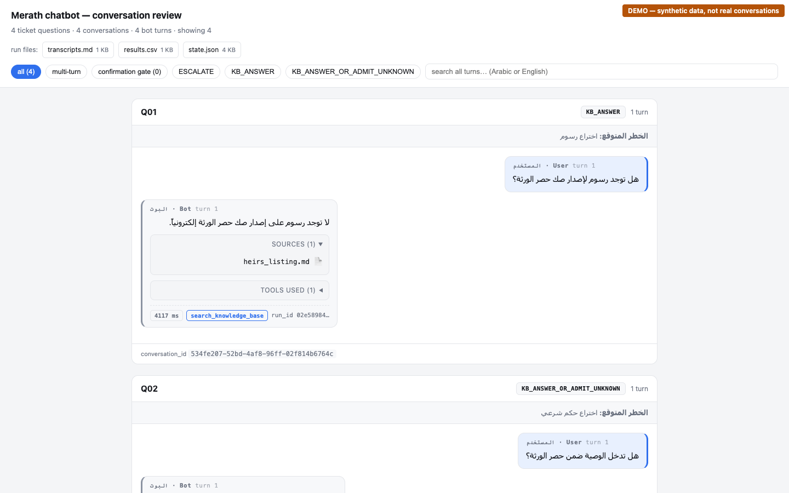
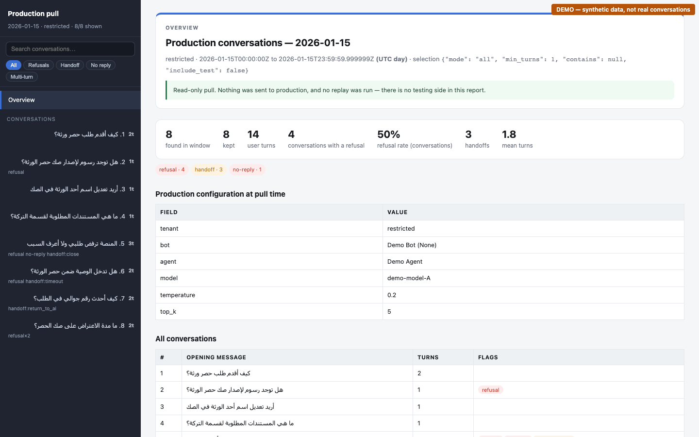
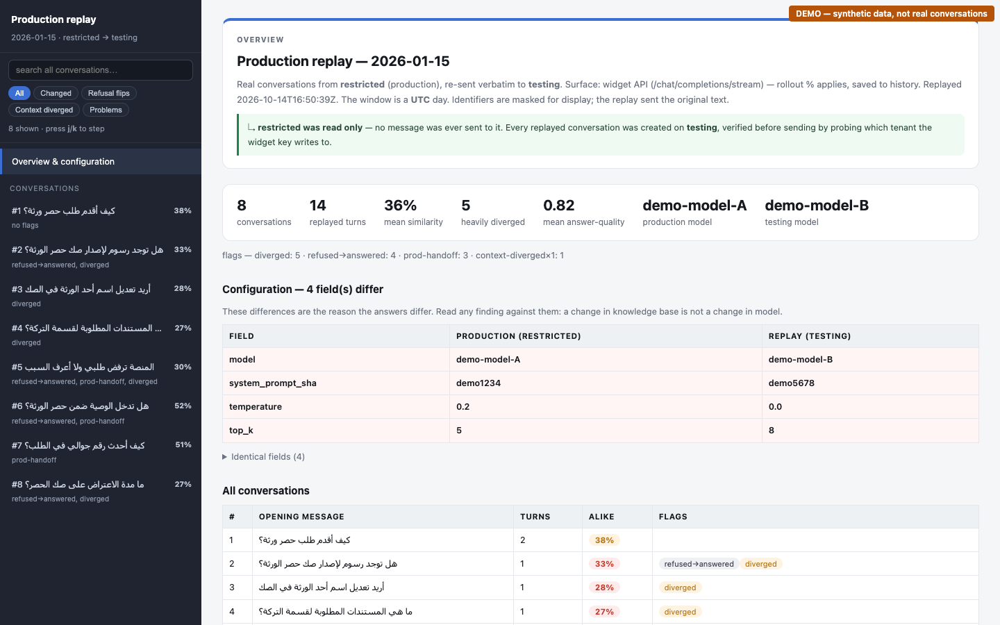
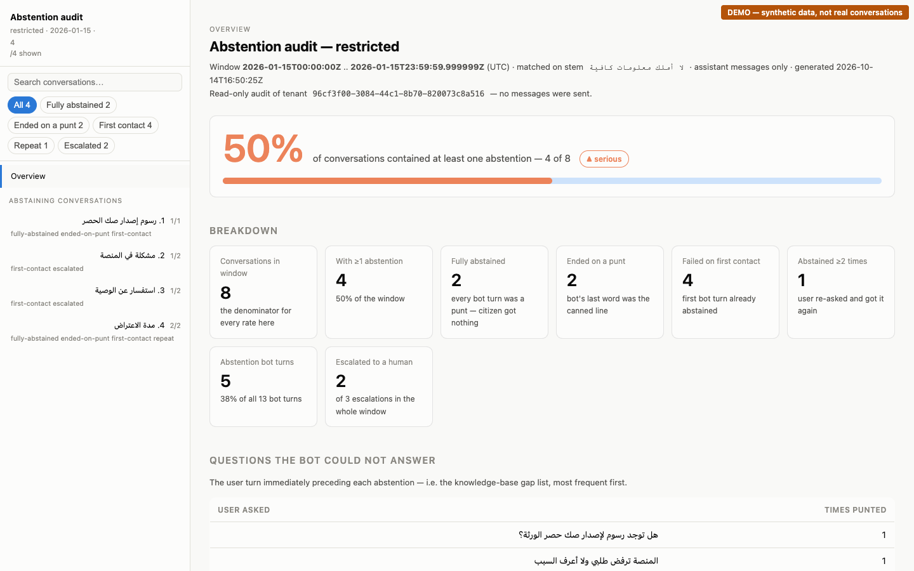
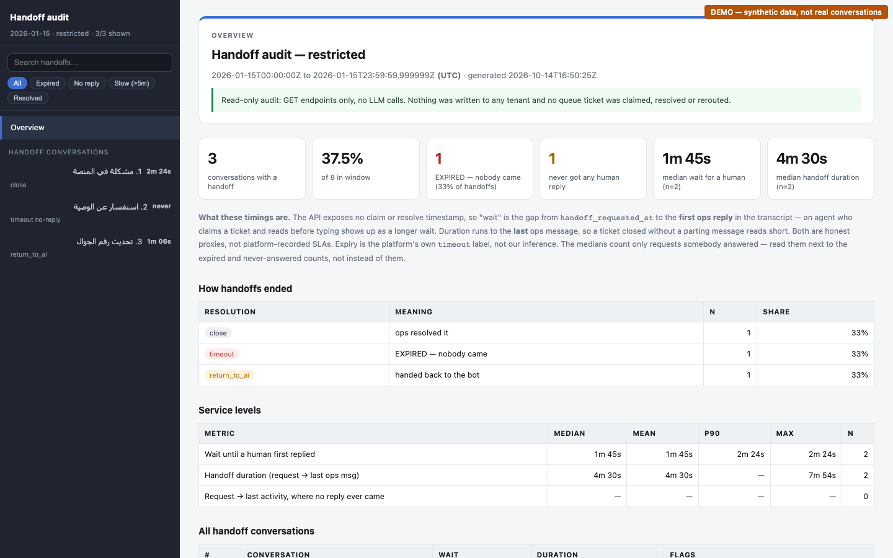
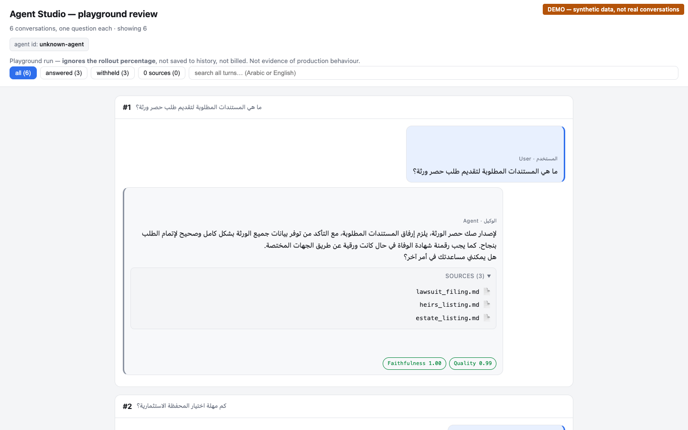

# AZM Chatbot Testing

QA harness for the **Merath / Tarekat chatbot** running on AZM Agent Studio.
It covers four things: automated API tests, LLM-judged golden answers, conversation runs for human review,
and read-only analysis of production traffic. It also ships six Claude Code skills that drive the tools for you.

> Method, cadence and triage rules: [`TESTING.md`](TESTING.md) · Known defects: [`FINDINGS.md`](FINDINGS.md)

---

## 1. Setup

```bash
python3 -m venv .venv
.venv/bin/pip install httpx pytest pytest-xdist pyyaml python-dotenv anthropic openpyxl
```

Create a `.env` file in the repo root. It is gitignored, so never commit it.

| Variable | Used by | Purpose |
|---|---|---|
| `AGENT_API`, `AGENT_API_KEY`, `AGENT_ORIGIN` | tests, conversation runs, replay | Widget API (publishable key, one tenant) |
| `STUDIO_URL`, `STUDIO_EMAIL`, `STUDIO_PASSWORD` | prod pull, replay, audits, Studio tests | Admin API (JWT, cross-tenant read) |
| `ANTHROPIC_API_KEY` | `judge.py`, `-m tickets` | Semantic grading. Without it, the graded tests are skipped |
| `JUDGE_MODEL` *(optional)* | `judge.py` | Override the judge model |

Tenant aliases accepted by every `--tenant` flag: `restricted` (**production**), `testing`, `insaf`, `test`.

---

## 2. Repo layout

```
agent_client.py      widget API client — the only module that knows the SSE contract
judge.py             LLM judge: approved answer vs bot answer, graded on meaning
conftest.py          fixtures + Arabic-normalised assertions
tests/               pytest layers: contract · functional · robustness · tickets · perf
tools/               CLIs: conversation runs, prod pull, replay, audits, renderers
data/                golden sets, scenarios, ticket templates
.claude/skills/      Claude Code skills that drive the tools (see §4)
reports/             generated output — gitignored
```

---

## 3. Using the repo directly

### 3.1 Automated test suite

```bash
.venv/bin/pytest                         # contract + functional + robustness + tickets
.venv/bin/pytest -m contract             # ~70 s — run on every vendor deploy
.venv/bin/pytest -m functional -n 6      # golden Q&A from data/golden.yaml
.venv/bin/pytest -m robustness -n 6      # injection, authz, PII, handoff, edge inputs
.venv/bin/pytest -m tickets -n 6         # spreadsheet Q&A, graded by the LLM judge
.venv/bin/pytest -m perf                 # latency & concurrency (slow, opt-in)
```

Re-run a single failure serially to tell non-determinism from a real regression:

```bash
.venv/bin/pytest "tests/test_functional.py::test_golden[<case-id>]"
```

Add a case to `data/golden.yaml`:

```yaml
- id: kb-my-new-case
  q: "سؤال المستخدم"
  expect: { searched_kb: true, abstains: false, all_of: ["حقيقة"], none_of: ["SA0"], lang: ar }
```

### 3.2 Approved answers from a spreadsheet

```bash
.venv/bin/python tools/redact_tickets.py data/tickets.csv --out data/tickets_redacted.csv   # optional PII scrub
.venv/bin/python tools/import_tickets.py data/tickets_redacted.csv                          # → data/golden_tickets.yaml
.venv/bin/pytest -m tickets -n 6
```

Column format: [`data/tickets_template.csv`](data/tickets_template.csv). Arabic headers are accepted.
To check the judge's calibration, run `.venv/bin/python judge.py`.

### 3.3 Conversation runs (transcripts for human review)

```bash
.venv/bin/python tools/run_conversations.py ask      data/golden_investment_division.csv
.venv/bin/python tools/run_conversations.py scenario data/conversation_scenarios.yaml
.venv/bin/python tools/run_conversations.py deepen   --target 4
.venv/bin/python tools/run_conversations.py reply    replies.json      # {"Q03": "follow-up"}
.venv/bin/python tools/run_conversations.py export
.venv/bin/python tools/render_html.py                                  # → reports/conversations/report.html
.venv/bin/python tools/run_conversations.py archive  --label my-run
```

### 3.4 Production analysis (read-only, admin API)

| Task | Command |
|---|---|
| Pull a day of prod conversations | `.venv/bin/python tools/pull_prod_conversations.py --day 2026-09-10 --all` |
| Render a pull | `.venv/bin/python tools/render_pull_html.py data/prod_pulls/restricted/2026-09-10/pull.json` |
| Replay prod on testing | `.venv/bin/python tools/replay_conversations.py data/prod_pulls/restricted/2026-09-10/pull.json` |
| Render the replay diff | `.venv/bin/python tools/render_replay_html.py reports/replay/restricted-to-testing/2026-09-10` |
| Abstention audit | `.venv/bin/python tools/abstention_audit.py --tenant restricted --day 2026-09-10` |
| Handoff SLA audit | `.venv/bin/python tools/handoff_audit.py --days 4 --cross-check` |

Common flags: `--start/--end` (full ISO bounds), `--last-hours N`, `--limit N`, `--count-only`, `--fresh`, `--include-test`.

> The replay sends real users' messages to the testing agent, which costs LLM calls. The pull and the audits only issue GETs.
> Production data lands in `data/prod_pulls/` and `reports/`. Both are gitignored, so keep it that way.

---

## 4. Claude Code skills

The skills live in [`.claude/skills/`](.claude/skills/). Open Claude Code in this repo and they load automatically.
Trigger a skill by typing `/<skill-name>`, or describe the task in plain words.

| Skill | What it does | Example prompt |
|---|---|---|
| [`chatbot-conversation-run`](.claude/skills/chatbot-conversation-run/SKILL.md) | Question CSV → one isolated conversation per question → replies where the bot asks for input → HTML review report | `/chatbot-conversation-run data/golden_investment_division.csv` |
| [`pull-prod-conversations`](.claude/skills/pull-prod-conversations/SKILL.md) | Read-only pull of real prod conversations for a day/window → PII-masked HTML report | "pull production conversations for 2026-09-10" |
| [`replay-prod-conversations`](.claude/skills/replay-prod-conversations/SKILL.md) | Replays a prod day's user turns on Tarekat-Testing → side-by-side prod-vs-testing HTML diff | "replay yesterday's prod traffic on testing" |
| [`abstention-audit`](.claude/skills/abstention-audit/SKILL.md) | Rate of the canned "لا أملك معلومات كافية…" reply, who got nothing, KB gaps | "is the bot effective? abstention rate for the last 24h" |
| [`handoff-audit`](.claude/skills/handoff-audit/SKILL.md) | Handoff volume, time-to-first-human-reply, duration, expired requests | "handoff SLA for the last 4 days" |
| [`test-chatbot-studio`](.claude/skills/test-chatbot-studio/SKILL.md) | Drives the agent's **Test** tab in the Studio admin portal and captures answer, sources, quality and faithfulness | `/test-chatbot-studio` |

Each skill runs the matching `tools/` scripts and writes an HTML report under `reports/`. See each `SKILL.md` for its inputs.
`test-chatbot-studio` also needs [`playwright-cli`](https://www.npmjs.com/package/@playwright/cli) on your `PATH`.

---

## 5. Example output

> **These screenshots use synthetic demo data.** Every conversation in them was invented. The real tools and renderers ran unchanged, with the Studio and widget clients replaced by offline fakes. Production reports look the same but are never committed.

### `chatbot-conversation-run`
Each question gets its own thread. The expected behaviour and risk are shown on every card, and each bot turn shows its sources, tools, latency and `run_id`.


### `pull-prod-conversations`
A read-only day of production traffic. It shows the refusal and handoff rate, the config at pull time, and an index of all conversations.


### `replay-prod-conversations`
Production compared with testing. It shows the config fields that differ, similarity per conversation, and refusal↔answer flips.


### `abstention-audit`
The share of conversations where the bot punted, with a breakdown and the list of knowledge-base gaps.


### `handoff-audit`
Handoff volume, how many expired, time-to-first-human-reply and handoff duration.


### `test-chatbot-studio`
A Studio Test-tab run with each answer's sources and its faithfulness and quality scores. Rendered from the skill's bundled `sample_results.json`.


---

## 6. Suggested cadence

| When | Run |
|---|---|
| Every vendor deploy | `pytest -m contract` |
| Every KB / prompt / model change | full `pytest` + `replay-prod-conversations` |
| Before a release | full run + `-m perf` + `test-chatbot-studio` + manual widget pass |
| Weekly | `abstention-audit` + `handoff-audit` on `restricted` |
