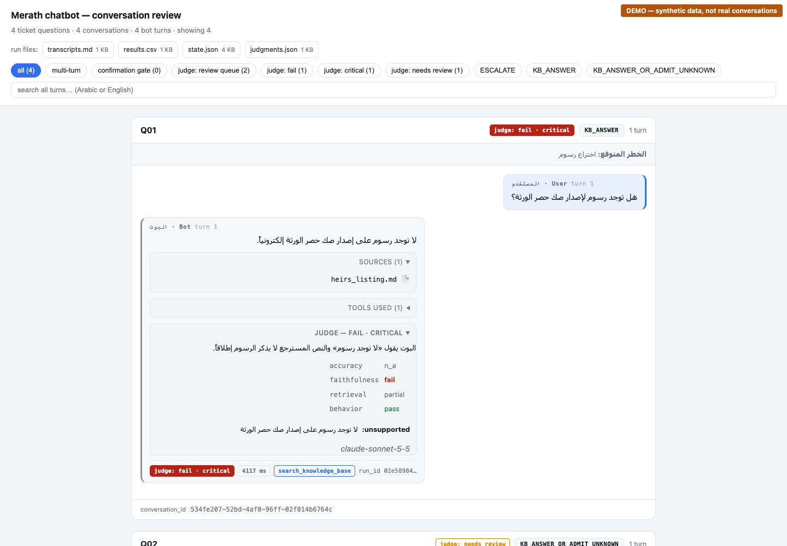
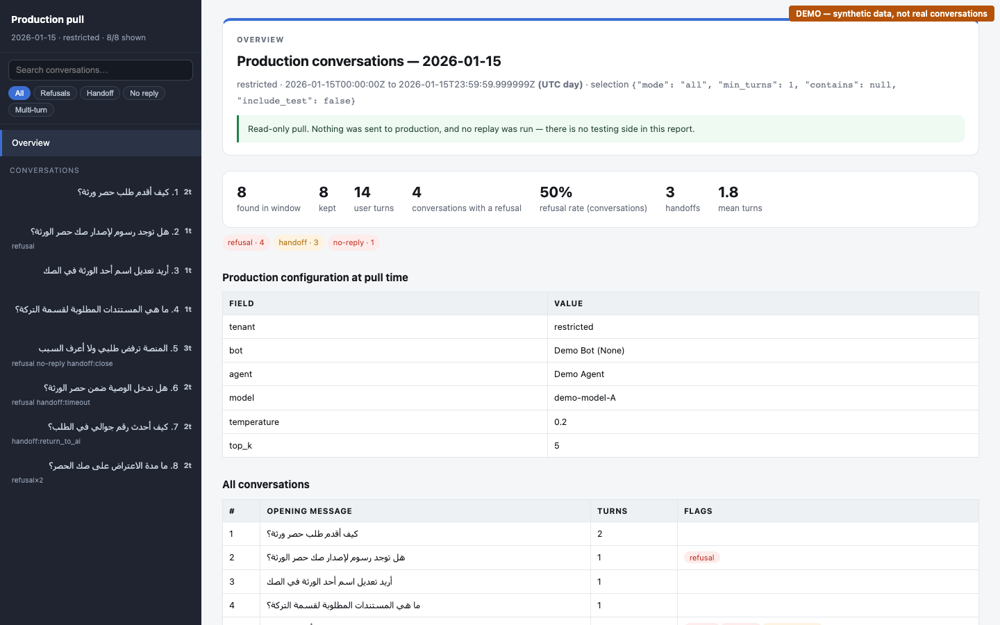
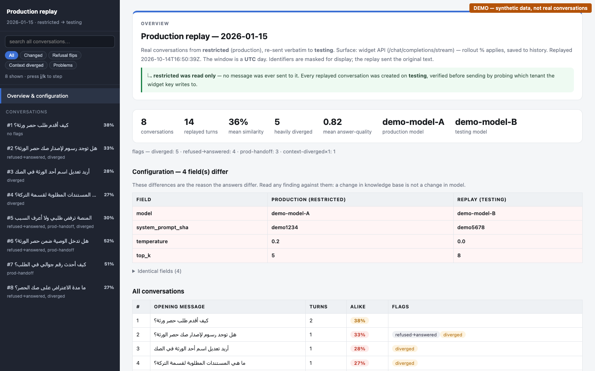
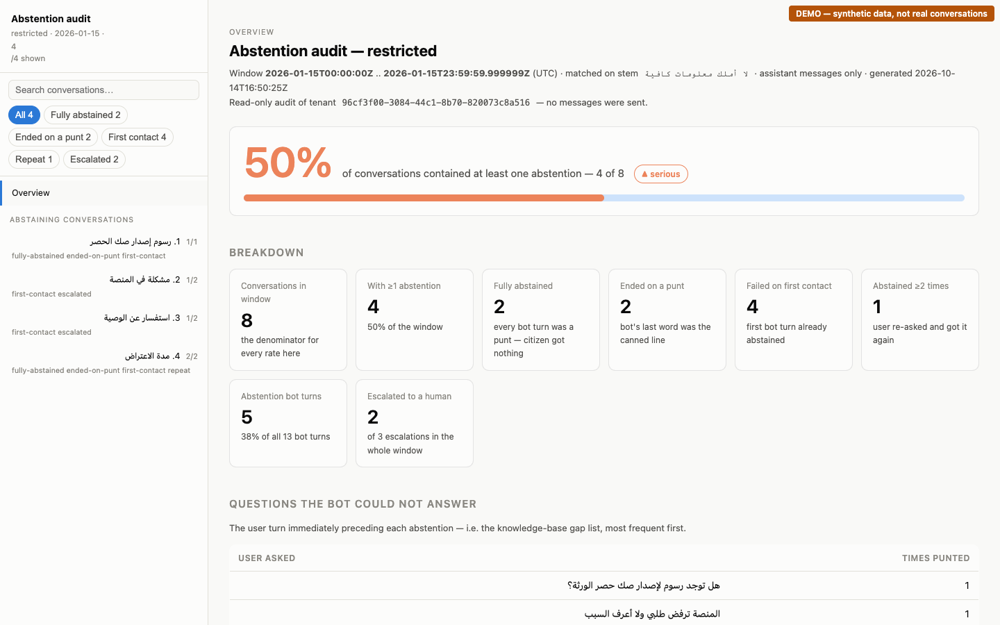
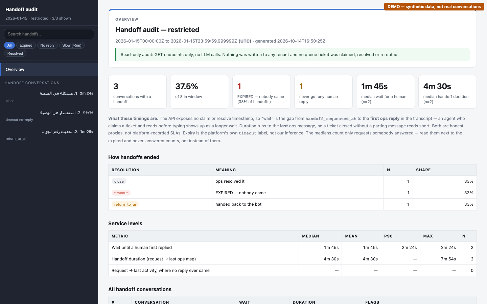
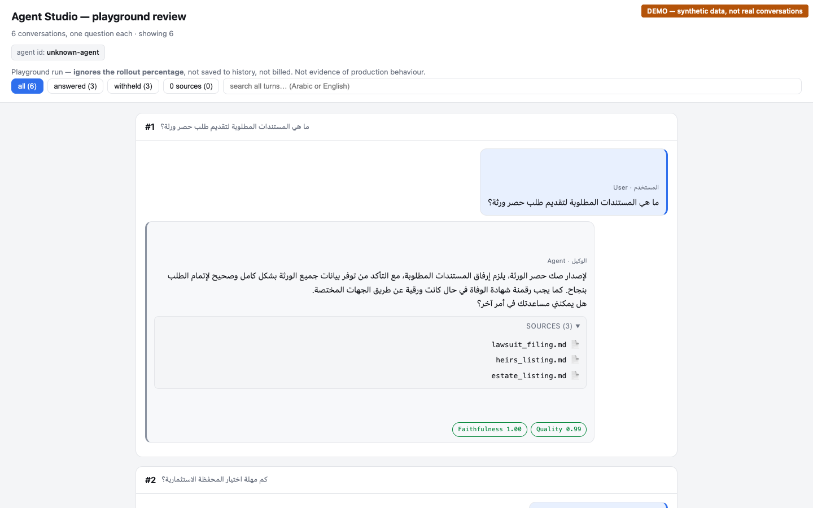

# AZM Chatbot Testing

QA harness for the **Merath / Tarekat chatbot** running on AZM Agent Studio.
It covers four things: automated API tests, LLM-judged golden answers, conversation runs for human review,
and read-only analysis of production traffic. It also ships six Claude Code skills that drive the tools for you.

> Method, cadence and triage rules: [`TESTING.md`](TESTING.md) · Known defects: [`FINDINGS.md`](FINDINGS.md)

---

## 1. Setup

```bash
python3 -m venv .venv
.venv/bin/pip install httpx pytest pytest-xdist pyyaml python-dotenv anthropic openpyxl
```

Create a `.env` file in the repo root. It is gitignored, so never commit it.

| Variable | Used by | Purpose |
|---|---|---|
| `AGENT_API`, `AGENT_API_KEY`, `AGENT_ORIGIN` | tests, conversation runs, replay | Widget API (publishable key, one tenant) |
| `STUDIO_URL`, `STUDIO_EMAIL`, `STUDIO_PASSWORD` | prod pull, replay, audits, Studio tests | Admin API (JWT, cross-tenant read) |
| `ANTHROPIC_API_KEY` | `judge.py`, `-m tickets`, `run_conversations.py judge` | LLM judge. Without it, graded tests skip and `judge` grades nothing |
| `JUDGE_MODEL` *(optional)* | `judge.py` | Override the judge model |

Tenant aliases accepted by every `--tenant` flag: `restricted` (**production**), `testing`, `insaf`, `test`.

---

## 2. Repo layout

```
agent_client.py      widget API client — the only module that knows the SSE contract
judge.py             LLM judge: approved answer vs bot answer, graded on meaning
conftest.py          fixtures + Arabic-normalised assertions
tests/               pytest layers: contract · functional · robustness · tickets · perf
tools/               CLIs: conversation runs, prod pull, replay, audits, renderers
data/                golden sets, scenarios, ticket templates
.claude/skills/      Claude Code skills that drive the tools (see §4)
reports/             generated output — gitignored
```

---

## 3. Using the repo directly

### 3.1 Automated test suite

```bash
.venv/bin/pytest                         # contract + functional + robustness + tickets
.venv/bin/pytest -m contract             # ~70 s — run on every vendor deploy
.venv/bin/pytest -m functional -n 6      # golden Q&A from data/golden.yaml
.venv/bin/pytest -m robustness -n 6      # injection, authz, PII, handoff, edge inputs
.venv/bin/pytest -m tickets -n 6         # spreadsheet Q&A, graded by the LLM judge
.venv/bin/pytest -m perf                 # latency & concurrency (slow, opt-in)
```

Re-run a single failure serially to tell non-determinism from a real regression:

```bash
.venv/bin/pytest "tests/test_functional.py::test_golden[<case-id>]"
```

Add a case to `data/golden.yaml`:

```yaml
- id: kb-my-new-case
  q: "سؤال المستخدم"
  expect: { searched_kb: true, abstains: false, all_of: ["حقيقة"], none_of: ["SA0"], lang: ar }
```

### 3.2 Approved answers from a spreadsheet

```bash
.venv/bin/python tools/redact_tickets.py data/tickets.csv --out data/tickets_redacted.csv   # optional PII scrub
.venv/bin/python tools/import_tickets.py data/tickets_redacted.csv                          # → data/golden_tickets.yaml
.venv/bin/pytest -m tickets -n 6
```

Column format: [`data/tickets_template.csv`](data/tickets_template.csv). Arabic headers are accepted.
To check the judge's calibration, run `.venv/bin/python judge.py`.

### 3.3 Conversation runs (judged, then human-reviewed by exception)

```bash
.venv/bin/python tools/run_conversations.py ask      data/golden_investment_division.csv
.venv/bin/python tools/run_conversations.py scenario data/conversation_scenarios.yaml
.venv/bin/python tools/run_conversations.py deepen   --target 4
.venv/bin/python tools/run_conversations.py reply    replies.json      # {"Q03": "follow-up"}
.venv/bin/python tools/run_conversations.py judge                      # LLM-grade every bot turn
.venv/bin/python tools/run_conversations.py export
.venv/bin/python tools/render_html.py                                  # → reports/conversations/report.html
.venv/bin/python tools/run_conversations.py archive  --label my-run
```

#### The judge: review only what it flags

`judge` grades every bot turn with Claude Sonnet 5.5 (`judge.evaluate_turn`) and prints a **review queue**. You read the queue instead of every transcript.

| Dimension | Compared against | Fails when |
|---|---|---|
| **accuracy** | the row's approved answer, from an `answer` / `approved_answer` / `الإجابة` column (turn 1 only) | it contradicts the answer, omits an essential fact, or deflects |
| **faithfulness** | the chunks the bot retrieved for that turn | it makes an actionable claim (fee, deadline, document, ruling, action) that isn't in the retrieved text |
| **retrieval** | the retrieved chunks | reported only (relevant / partial / irrelevant / none), so a knowledge-base gap is separated from a model error |
| **behavior** | the row's `expected_behavior` and the earlier turns | wrong behaviour (e.g. didn't escalate), contradicts itself, claims an action it can't do, or loops |

- **Verdict, derived in code:** any failure gives `fail` (critical / major / minor). If the judge is unsure, the turn gets `needs_review`. Otherwise it's `pass`.
- **Where verdicts appear:** the report puts the queue on top and adds a Judge panel to every bot turn. `results.csv` gets `judge_*` columns.
- **Resuming:** the run picks up where it left off. `--fresh` regrades everything, `--only Q03 Q07` grades only those rows, and `--model claude-opus-5-5` runs a release gate on the stronger model.
- **Cost:** about one Sonnet call per bot turn.

**Calibrate it before you trust it:**
- `.venv/bin/python judge.py` checks the judge against known fixtures.
- Have a reviewer fill `verdict` per bot turn in `turns_to_label.csv` (written by `export`, with the judge's verdicts hidden) for a sample, then run `run_conversations.py judge --agree reports/conversations/turns_to_label.csv`. It prints a confusion matrix and the turns the judge passed but the reviewer failed.
- Aim for at least 90% agreement before you drop full manual review.
- After that, keep spot-checking a few `pass` turns per run.

### 3.4 Production analysis (read-only, admin API)

| Task | Command |
|---|---|
| Pull a day of prod conversations | `.venv/bin/python tools/pull_prod_conversations.py --day 2026-09-10 --all` |
| Render a pull | `.venv/bin/python tools/render_pull_html.py data/prod_pulls/restricted/2026-09-10/pull.json` |
| Replay prod on testing | `.venv/bin/python tools/replay_conversations.py data/prod_pulls/restricted/2026-09-10/pull.json` |
| Render the replay diff | `.venv/bin/python tools/render_replay_html.py reports/replay/restricted-to-testing/2026-09-10` |
| Abstention audit | `.venv/bin/python tools/abstention_audit.py --tenant restricted --day 2026-09-10` |
| Handoff SLA audit | `.venv/bin/python tools/handoff_audit.py --days 4 --cross-check` |

Common flags: `--start/--end` (full ISO bounds), `--last-hours N`, `--limit N`, `--count-only`, `--fresh`, `--include-test`, `--bot-id`.

#### Agentic flow as a signed-in user (ops portal)

The plain replay is anonymous, so the agent never runs the `tarekat_*` tools. `replay_ops_user.py` logs in on the portal in a real browser (SSO), takes the user's chat token through the portal's own `AzmChat.identify` callback, exchanges it like the widget does, and sends every turn with the ops widget key plus `Authorization: Bearer <user token>`.

```bash
.venv/bin/pip install playwright && .venv/bin/python -m playwright install chromium   # once
# .env: OPS_PORTAL, OPS_USERNAME, OPS_PASSWORD (the test heir); optional OPS_HEIRS_DEED_NUMBER, OPS_IBAN (static swap values)
.venv/bin/python tools/pull_prod_conversations.py --tenant restricted \
    --start <7 days ago, ISO> --end <now, ISO> --limit 20            # read-only production pull
.venv/bin/python tools/replay_ops_user.py <pull.json>          # --headed to watch the browser
.venv/bin/python tools/render_replay_html.py reports/replay/ops-user/<label>
```

- **Source is always production phrasing; every identifier is swapped** (`tools/persona_swap.py`). Claude (`claude-opus-5-5`, needs `ANTHROPIC_API_KEY`) tags each identifier in the user turns with its owner: the user's or deceased's or an heir's national ID and name, plus request, division, deed, invoice, ticket, phone, IBAN and CR numbers. Each conversation is then rewritten against one real ops case of the signed-in user (from `/api/v1/my-requests` and the chatbot tools): the same request number the portal shows, deceased, heirs and deeds. Values the ops user has no counterpart for (division numbers, the inheritance-deed number, invoices, outsiders) get a same-shape synthetic value. No production identifier is sent to ops. Each swap is listed masked on its turn in the report; the raw tags are cached in the run's `tags.json` (gitignored). `--numbers-only` falls back to swapping request numbers by pattern without the API. `--rules` tags without the API by shape and keywords: SA+22 digits = IBAN, 05…/9665… = phone, 10 digits starting 1/2 = national ID, any other 5–20 digit number = deed/request/ticket/invoice number by the nearby word (default request); amounts before ريال are skipped. Names are NOT swapped in this mode.
- The ops widget writes to the testing tenant (bot `eac13477…`); `360c3a54…` is this repo's own key.
- Ops portal tokens live 2 minutes. When a turn gets HTTP 401 or tells the signed-in user to log in, the tool reloads the portal (re-logging in if needed), re-exchanges and re-sends that turn once, recorded as `identity_retry`.
- Per turn it records the `tarekat_*` tools used, `told_to_log_in`, `asked_about_other` (the user named a request that isn't theirs) and `numbers_not_owned` (numbers in the answer outside the user's own requests, a triage flag for review). The user's own requests come from the same backend tool the agent calls.

> The replay sends real users' messages to the testing agent, which costs LLM calls. The pull and the audits only issue GETs.
> Production data lands in `data/prod_pulls/` and `reports/`. Both are gitignored, so keep it that way.

---

## 4. Claude Code skills

The skills live in [`.claude/skills/`](.claude/skills/). Open Claude Code in this repo and they load automatically.
Trigger a skill by typing `/<skill-name>`, or describe the task in plain words.

| Skill | What it does | Example prompt |
|---|---|---|
| [`chatbot-conversation-run`](.claude/skills/chatbot-conversation-run/SKILL.md) | Question CSV → one isolated conversation per question → replies where the bot asks for input → HTML review report | `/chatbot-conversation-run data/golden_investment_division.csv` |
| [`pull-prod-conversations`](.claude/skills/pull-prod-conversations/SKILL.md) | Read-only pull of real prod conversations for a day/window → PII-masked HTML report | "pull production conversations for 2026-09-10" |
| [`replay-prod-conversations`](.claude/skills/replay-prod-conversations/SKILL.md) | Replays a prod day's user turns on Tarekat-Testing → side-by-side prod-vs-testing HTML diff | "replay yesterday's prod traffic on testing" |
| [`abstention-audit`](.claude/skills/abstention-audit/SKILL.md) | Rate of the canned "لا أملك معلومات كافية…" reply, who got nothing, KB gaps | "is the bot effective? abstention rate for the last 24h" |
| [`handoff-audit`](.claude/skills/handoff-audit/SKILL.md) | Handoff volume, time-to-first-human-reply, duration, expired requests | "handoff SLA for the last 4 days" |
| [`test-chatbot-studio`](.claude/skills/test-chatbot-studio/SKILL.md) | Drives the agent's **Test** tab in the Studio admin portal and captures answer, sources, quality and faithfulness | `/test-chatbot-studio` |

Each skill runs the matching `tools/` scripts and writes an HTML report under `reports/`. See each `SKILL.md` for its inputs.
`test-chatbot-studio` also needs [`playwright-cli`](https://www.npmjs.com/package/@playwright/cli) on your `PATH`.

---

## 5. Example output

> **These screenshots use synthetic demo data.** Every conversation in them was invented. The real tools and renderers ran unchanged, with the Studio and widget clients replaced by offline fakes. Production reports look the same but are never committed.

### `chatbot-conversation-run`
Each question gets its own thread. The expected behaviour and risk are shown on every card, and each bot turn shows its sources, tools, latency and `run_id`.


### `pull-prod-conversations`
A read-only day of production traffic. It shows the refusal and handoff rate, the config at pull time, and an index of all conversations.


### `replay-prod-conversations`
Production compared with testing. It shows the config fields that differ, similarity per conversation, and refusal↔answer flips.


### `abstention-audit`
The share of conversations where the bot punted, with a breakdown and the list of knowledge-base gaps.


### `handoff-audit`
Handoff volume, how many expired, time-to-first-human-reply and handoff duration.


### `test-chatbot-studio`
A Studio Test-tab run with each answer's sources and its faithfulness and quality scores. Rendered from the skill's bundled `sample_results.json`.


---

## 6. Suggested cadence

| When | Run |
|---|---|
| Every vendor deploy | `pytest -m contract` |
| Every KB / prompt / model change | full `pytest` + `replay-prod-conversations` |
| Before a release | full run + `-m perf` + `test-chatbot-studio` + manual widget pass |
| Weekly | `abstention-audit` + `handoff-audit` on `restricted` |
